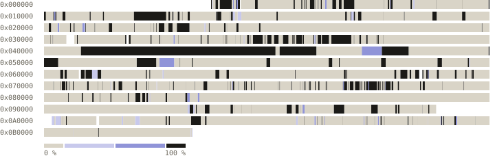

# BattleTanx decompilation

A matching decompilation of *BattleTanx* for the Nintendo 64.

> **This repository contains no game content.** You must supply a legally acquired cartridge dump. Builds are verified against its SHA256.

## Progress

<!-- progress -->
<pre><code>all  [░░░░░░░░░░░░░░░░░░░░]   1.62% (~1.64%)  136,564 of 8,388,608 bytes</code> <code>us   [░░░░░░░░░░░░░░░░░░░░]   1.62% (~1.64%)  136,564 of 8,388,608 bytes</code></pre>

| us (NUS-NBXE-0, North America). NTSC release. SHA256 `c5b7cf3523de025e3f18e2c8df2deb0eced5613e7c46cb8c6c5a4f22644ead3f` |
|---|
| <pre><code>code      [███░░░░░░░░░░░░░░░░░]  18.46% (~18.68%)  130,360 of 705,956</code> <code>data      [░░░░░░░░░░░░░░░░░░░░]   1.23%  2,108 of 170,652</code> <code>functions [███████▒░░░░░░░░░░░░]  38.38% (~40.09%)  674 of 1,756</code> <code>blobs     [░░░░░░░░░░░░░░░░░░░░]   0.00%  0 of 7,507,904</code></pre> |
<!-- /progress -->

## Development & Contributions

Contributions and corrections are welcome. Run `make check` before opening a pull request.

For detailed instructions please see [CONTRIBUTING.md](CONTRIBUTING.md).

## License

[CC0 1.0](LICENSE)

## Dependencies

<!-- dependencies -->
| Tool | Used for | Pinned archive |
|---|---|---|
| GCC 2.7.2 (KMC) | compiles C (`gcc-2.7.2-kmc`) | [gcc-2.7.2-linux.tar.gz](https://github.com/decompals/mips-gcc-2.7.2/releases/download/main/gcc-2.7.2-linux.tar.gz) sha256 `ff3e299c1d95` |
| n64link (SN ASN64-compatible assembler and linker) | assembles and links every unit | [n64link-v0.2.0-linux-x86_64.tar.gz](https://github.com/AbuN64/mas-n64/releases/download/v0.2.0/n64link-v0.2.0-linux-x86_64.tar.gz) sha256 `061d7bc69f21` |
<!-- /dependencies -->
